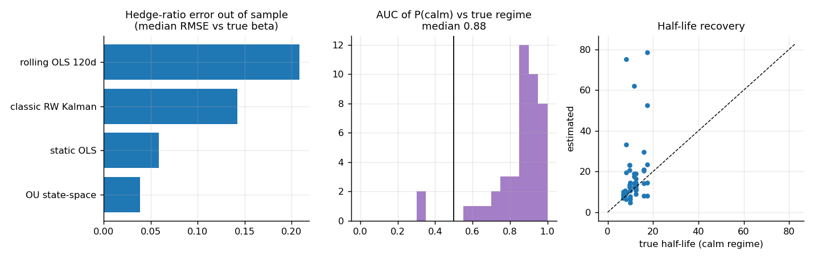
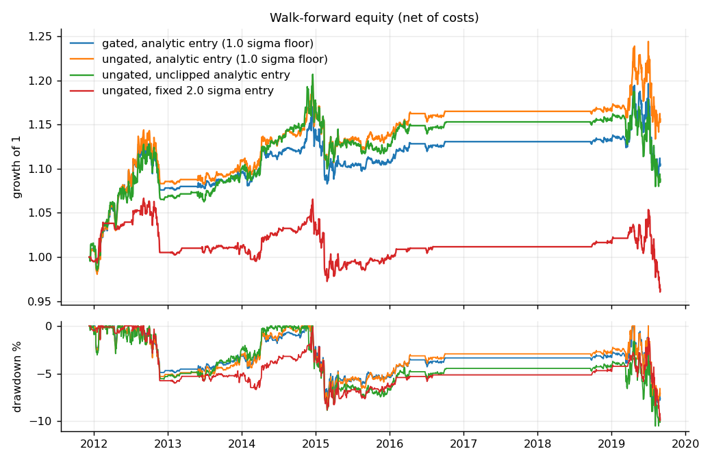
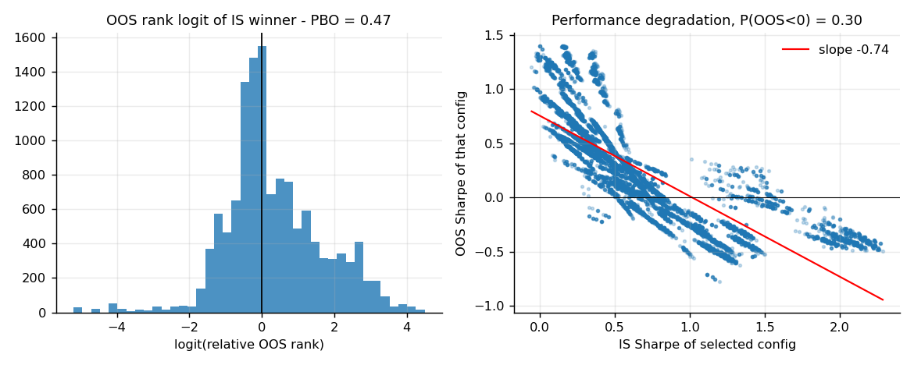
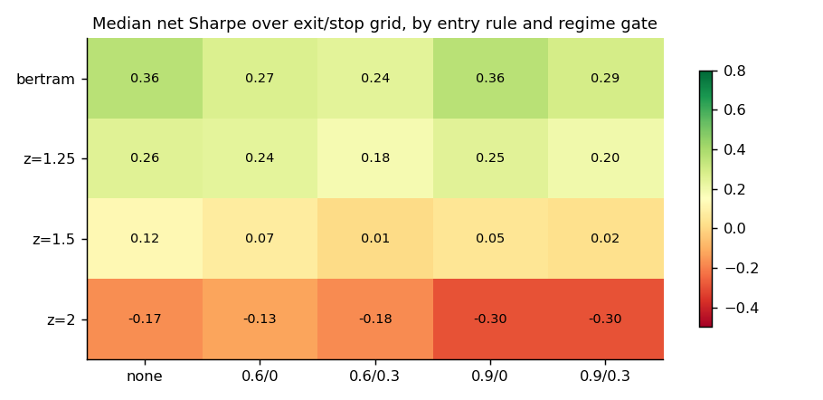
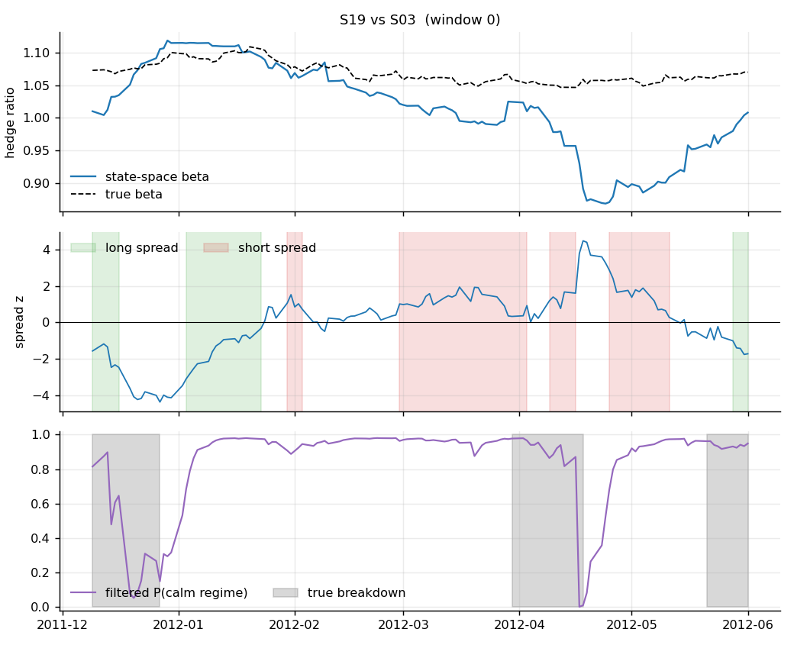

# regimearb

Regime-aware statistical arbitrage: a research framework for equity pairs trading that treats the
*validation* of a strategy as seriously as the strategy itself.

Most pairs-trading repos stop at "rolling OLS spread, enter at 2 sigma, plot equity curve". This one
asks three harder questions and builds tooling to answer them:

1. **Is the hedge ratio really constant, and is the "spread" really one thing?** A state-space model
   separates a slowly drifting hedge ratio from a fast mean-reverting deviation.
2. **When does a cointegrating relationship stop paying?** A Markov-switching AR(1) filter estimates,
   online and without look-ahead, the probability that the spread is in its calm regime.
3. **How much of a good backtest is selection luck?** Every strategy variant that was tried is scored
   with the Deflated Sharpe Ratio and the Probability of Backtest Overfitting.

Everything is written from scratch on numpy/scipy (the Kalman filter, the EM algorithm, the
combinatorial cross-validation), with numba as an optional accelerator, and checked against known
ground truth on simulated data.

> **Read this first.** The default experiments run on a *simulated* universe with planted
> cointegrated pairs. That is deliberate: it lets every estimator be tested against the truth. It also
> means the P&L numbers below say nothing about real-market alpha. The CLI accepts a CSV of real prices
> (`--csv`), but none of the results in this README come from real data.

---

## Pipeline

```
prices ──► screen pairs ──► fit per-pair models ──► signals ──► positions/P&L ──► validation
           (PCA residual     (OU state-space        (z-score,     (costs, lag,       (PSR / DSR,
            corr + EG test    Kalman, MS-AR(1)       P(calm),      borrow, vol        CSCV / PBO,
            + BH FDR)         regimes, Bertram       analytic      target)            bootstrap)
                              thresholds)            entry)
        └────────── formation window (trailing 504d) ──────────┘└── next 126d, models frozen ──┘
```

The walk-forward engine is split in two. Stage 1 (screening and model fitting, the slow part) runs
once per re-formation date. Stage 2 (turning stored signals into P&L for a given rule) is cheap,
which is what makes a 180-configuration sweep and the overfitting statistics on top of it practical.

## What is in here

| Component | File | Notes |
|---|---|---|
| Simulated universe with ground truth | `data/synthetic.py` | GARCH market factor, sector factors, planted pairs with drifting beta and a two-regime OU spread, correlated-but-not-cointegrated decoys |
| Pair screening | `selection/pairs.py` | PCA-residual correlation pre-screen, Engle-Granger both directions, Benjamini-Hochberg FDR, asset-reuse cap |
| OU state-space Kalman filter | `models/kalman.py` | Hedge ratio as a random walk, spread as its own AR(1) state; MLE of noise parameters; hand-unrolled 2x2 algebra (numba-compilable) |
| Markov-switching AR(1) | `models/regime.py` | Baum-Welch with scaled forward-backward, multiple starts, causal `filter` vs look-ahead `smooth`, BIC test against a single regime |
| Analytic thresholds | `models/ou.py` | Bertram (2010) profit-rate-optimal entry as a function of cost / spread volatility |
| Trading rule | `strategy/` | State machine with stop, time stop, regime exit, probability sizing |
| Backtest engine | `backtest/engine.py` | Walk-forward, execution lag, proportional costs, short borrow, optional vol targeting, trade log |
| Overfitting controls | `validation/` | PSR, DSR, minimum track-record length, stationary bootstrap, CSCV / PBO |
| Ground-truth diagnostics | `diagnostics.py` | Hedge-ratio RMSE vs baselines, regime AUC, half-life recovery, selection precision |

## Quickstart

```bash
pip install -e ".[fast,dev]"      # numba is optional; it speeds up the filters and EM
pytest                            # 33 tests

regimearb run      --out results/run        # walk-forward backtest, 4 rule variants
regimearb sweep    --out results/sweep      # 180 configs -> DSR + PBO
regimearb diagnose --out results/diagnose   # estimators vs ground truth

regimearb run --csv prices.csv              # your own wide CSV of adjusted closes
```

Configuration lives in `configs/default.toml`. Runs are deterministic (seeded); each command took
roughly 10 seconds with numba on the machine used for the numbers below.

## Results (simulated data, 2,520 days, 34 assets, 10 planted pairs)

Numbers below are reproduced by the commands above. All are after costs (8 bps per unit of traded
notional, 50 bps/yr borrow on shorts) and a one-day execution delay.

### 1. The estimators recover the truth

`regimearb diagnose` fits each model on 504 days and scores it on the next 126 days, for every
planted pair across several windows:

| Hedge-ratio estimator | Out-of-sample RMSE vs true beta (median) |
|---|---|
| Static OLS | 0.059 |
| Rolling OLS, 120d | 0.208 |
| Classic random-walk Kalman ([beta, alpha], fixed `delta`) | 0.142 |
| **OU state-space (this repo)** | **0.039** |

The regime filter separates calm from breakdown days with a median out-of-sample AUC of 0.88
(IQR 0.81-0.94, n = 43), and the estimated half-life is off by a median of 2.9 days against a median
true value of 10.9 days.



The classic Kalman baseline is worse than static OLS here. A likely reason is that letting
`[beta, alpha]` absorb the spread makes the filter chase mean-reverting noise as if it were
hedge-ratio drift; modelling the spread as its own state avoids that. (The baseline uses the common
fixed `delta = 1e-4`; it would do better with tuned noise, but so would everything else.)

### 2. Backtest

| Variant | Net Sharpe | Gross Sharpe | Ann. return | Ann. vol | Max DD |
|---|---|---|---|---|---|
| Regime gate + analytic entry (1.0 sigma floor) | 0.31 | 0.51 | 1.3% | 4.3% | -9.4% |
| No gate + analytic entry (1.0 sigma floor) | 0.39 | 0.60 | 1.8% | 4.9% | -8.9% |
| No gate + unclipped analytic entry | 0.23 | 0.48 | 1.1% | 5.2% | -10.5% |
| No gate + fixed 2.0 sigma entry | -0.10 | 0.02 | -0.5% | 3.9% | -10.0% |



Reading this honestly:

- **Entering earlier than the textbook 2 sigma is what matters, and the Bertram formula is only
  part of the story.** With realistic costs the continuous-time optimum lands well inside 1 sigma
  (median 0.70 stationary standard deviations on this data). Used unclipped it trades a lot and does
  worse (Sharpe 0.23, turnover up about 30%), because the formula assumes continuous monitoring and
  perfectly known parameters, and neither holds with daily bars and a 504-day fit. The default clips
  the level to [1, 3] sigma, and the floor binds in 94% of pair-windows, so in practice this variant
  behaves like a fixed 1.0 sigma entry (which gives Sharpe 0.39 as well). What the analytic level
  contributes is the *direction* (cost-aware entry sits well below 2 sigma) and a per-pair scale that
  the clip mostly overrides. The 1.0 sigma floor was set as a sanity bound before seeing results, and
  lowering it did not help.
- **The regime gate did not improve Sharpe at the default settings.** The filter itself is accurate
  (AUC 0.88), but converting that into a better trading rule is a different problem: gating removes
  some losers along with some winners. Only the strictest setting in the sweep (`gate_in = 0.9`)
  edges out no-gate, and not by an amount that survives the overfitting tests below.
- **The Sharpe is not statistically distinguishable from zero.** A stationary-bootstrap 95% interval
  for the default variant is [-0.34, 1.01].
- The flat stretches in the equity curve are windows where the FDR-controlled screen found nothing
  worth trading (4 of 16 re-formation dates). That is the screen being conservative, not a bug.

### 3. How much of the best backtest is luck?

`regimearb sweep` runs 180 configurations (entry rule x exit level x stop x regime gate) on the same
signal panel and asks what the best one is worth after accounting for the search:

| Statistic | Value |
|---|---|
| Configurations tried | 180 |
| Best config net Sharpe (annualised) | 0.45 |
| Sharpe expected from the best of 180 *no-skill* trials | 0.58 |
| Probabilistic Sharpe Ratio vs 0 | 0.90 |
| **Deflated Sharpe Ratio** | **0.37** |
| **Probability of Backtest Overfitting (CSCV, 12,870 splits)** | **0.47** |
| Share of configs with positive Sharpe | 70% |
| Minimum track record for the best config to clear 0 at 5% | ~13 years |



The best configuration looks respectable in isolation (PSR 0.90) and unremarkable once the search is
priced in (DSR 0.37, PBO 0.47, roughly a coin flip on whether the in-sample winner beats the median
out of sample). Selecting from this grid would not be justified by these data. That is the answer the
tooling is meant to give, and it is the right answer here: the simulated edge is small by design and
the grid is large.



### One pair, in detail



Top: estimated hedge ratio against the true, hidden path. Middle: spread z-score with the positions
the rule takes. Bottom: filtered probability of the calm regime against the true breakdown episodes
(grey). The filter reacts some days after a breakdown starts, which is inherent to online filtering.

## Design decisions worth knowing about

- **No look-ahead, and tested.** Models are fit on the formation window, frozen, and run forward.
  `tests/test_backtest.py` checks that shocking future prices leaves earlier signals untouched, and that
  truncating the price history leaves earlier walk-forward windows identical. Smoothed regime
  probabilities exist (`smooth`) for diagnostics but are never used for signals.
- **Execution delay by default.** A signal at the close of day t is filled at the close of day t+1.
  Mean-reversion edges decay quickly, so a same-bar fill flatters the numbers.
- **Regime states are ordered by stationary dispersion, not by persistence.** On simulated data with
  known labels, ordering by AR coefficient gave a median out-of-sample AUC of 0.37 (worse than
  chance) because the two labels were often swapped: persistence over short breakdown episodes is
  poorly identified while dispersion is not. Ordering by dispersion gives 0.88.
- **A regime split is only learned if BIC supports it.** Otherwise the filter falls back to a fixed,
  untuned stress prior. Cointegration screens preferentially select windows *without* breakdowns, so
  the fallback is the common case (45 of 50 pair-windows in the default run).
- **Multiple testing is handled twice**: FDR control in pair selection, and DSR/PBO for the strategy
  search.

## Limitations

- Simulated data only in the reported results. The simulator encodes exactly the structure the models
  look for, so it validates the machinery, not the hypothesis.
- Daily bars, close-to-close fills, proportional costs. No market impact, borrow availability, or
  intraday effects. Positions are rebalanced to constant notional each day.
- All positions are flat at each re-formation date, which costs some turnover.
- The Bertram thresholds assume continuous-time OU dynamics and known parameters; daily sampling,
  estimation error and regime switching violate that (see the unclipped result above), so the
  levels are a guide rather than an optimum.
- The simulator's spreads are Gaussian AR(1) by construction, so the OU-based components are
  correctly specified here in a way they will not be on real data.
- `is_oos_slope` in the sweep report has a mechanical negative component (IS and OOS blocks partition
  the same series), so interpret it alongside PBO rather than on its own.
- On real data, survivorship bias in the universe and look-ahead in the ticker list are the first
  things to worry about.

## Roadmap

- Run on a point-in-time equity universe (survivorship-free) and report the same diagnostics
- Johansen-based baskets instead of pairs
- Purged / embargoed CV for model hyperparameters
- Regime-conditional position sizing calibrated on expected reversion speed rather than raw probability

## Layout

```
src/regimearb/
  data/         synthetic universe (with ground truth), csv / yfinance loaders
  selection/    correlation pre-screen, Engle-Granger, BH-FDR
  models/       kalman.py  ou.py  regime.py
  strategy/     pair_model.py (per-pair fit)  signals.py (trading state machine)
  backtest/     engine.py (walk-forward)  metrics.py
  validation/   stats.py (PSR/DSR/bootstrap)  cscv.py (PBO)
  diagnostics.py  sweep.py  viz.py  cli.py
tests/          33 tests: filter vs dense reference, EM monotonicity, Bertram vs Monte Carlo,
                CSCV vs brute force, causality, cost monotonicity, ...
docs/methodology.md   the maths
```

## References

- Engle, R. and Granger, C. (1987). Co-integration and error correction. *Econometrica* 55(2).
- Hamilton, J. (1989). A new approach to the economic analysis of nonstationary time series and the
  business cycle. *Econometrica* 57(2).
- Benjamini, Y. and Hochberg, Y. (1995). Controlling the false discovery rate. *JRSS-B* 57(1).
- Kass, R. and Raftery, A. (1995). Bayes factors. *JASA* 90(430).
- Gatev, E., Goetzmann, W. and Rouwenhorst, K. (2006). Pairs trading. *Review of Financial Studies* 19(3).
- Elliott, R., van der Hoek, J. and Malcolm, W. (2005). Pairs trading. *Quantitative Finance* 5(3).
- Avellaneda, M. and Lee, J.-H. (2010). Statistical arbitrage in the US equities market.
  *Quantitative Finance* 10(7).
- Bertram, W. (2010). Analytic solutions for optimal statistical arbitrage trading. *Physica A* 389(11).
- Politis, D. and Romano, J. (1994). The stationary bootstrap. *JASA* 89(428).
- Bailey, D. and Lopez de Prado, M. (2014). The deflated Sharpe ratio. *Journal of Portfolio Management* 40(5).
- Bailey, D., Borwein, J., Lopez de Prado, M. and Zhu, Q. (2017). The probability of backtest
  overfitting. *Journal of Computational Finance* 20(4).

## License

MIT
